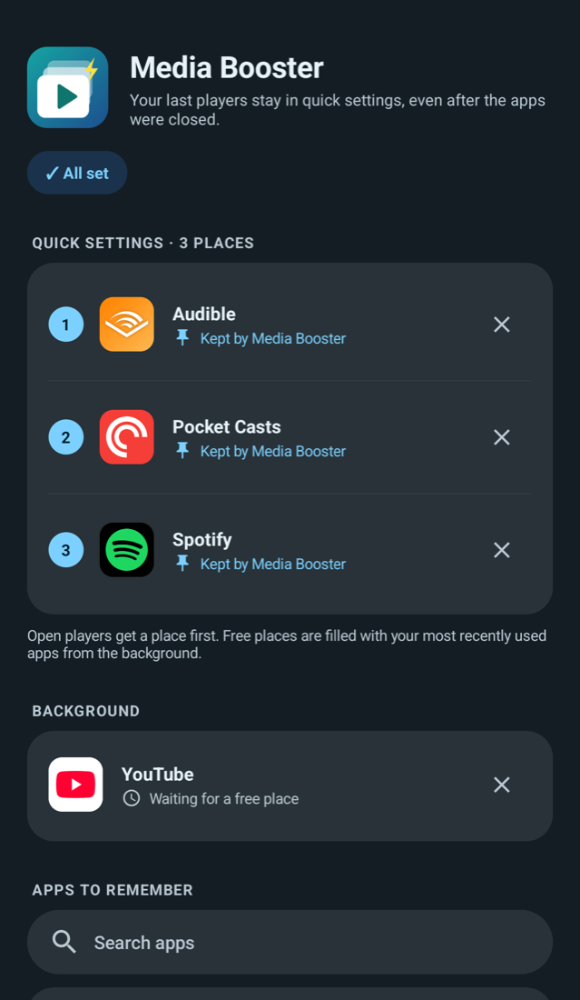

<p align="center">
  
</p>

<h1 align="center">Media Booster for OnePlus</h1>

<p align="center">
  <b>Your recent players stay in quick settings.</b><br>
  Even after OnePlus killed Spotify, Audible or Pocket Casts in the background.
</p>

<p align="center">
  <a href="https://github.com/Intersebbtor/media-booster/releases/latest"><b>Download</b></a> ·
  Android 12+ · Built for OnePlus / ColorOS · No internet permission · MIT
</p>

---

## The problem

OnePlus has a nice media tile in quick settings, with a player panel you can swipe through. But a player only shows up there while its app is still alive. OnePlus kills paused apps after a few minutes, and the system drops paused players after about 5 minutes anyway. So the tile mostly says *Not playing*.

## What Media Booster does

- **Keeps your last players in the panel.** When an app is gone, Media Booster shows a stand-in card with the last title, artist and cover. Play, pause and skip are forwarded to the real app.
- **3 places, used dynamically.** The panel shows at most 3 players. Players that are actually open (any app, also a browser) get a place first. Free places are filled with your most recently used apps.
- **Background queue.** Up to 5 recent apps are remembered. When a place frees up, the next one moves in.
- **You choose which apps.** Only apps you tick under *Apps to remember* get stand-ins. A website in your browser only shows while it's open.
- **Light on battery.** One small background service. No polling, no audio, no internet permission.

## Install

You need a computer with **adb** once. Android blocks notification access for apps installed by tapping an APK, and Media Booster cannot work without it.

### What you need

- Android 12+ (built and tested on OnePlus / ColorOS 16)
- Android Platform-Tools (`adb`) on your computer: [download](https://developer.android.com/tools/releases/platform-tools), or `brew install android-platform-tools` / `winget install Google.PlatformTools` / `sudo apt install adb`
- USB debugging on your phone: Settings → About phone → tap **Build number** 7 times, then Settings → System → Developer options → **USB debugging**

### 1. Install the 4 APKs

From the [latest release](https://github.com/Intersebbtor/media-booster/releases/latest) download:

- `MediaBooster-x.y.z.apk` (the app)
- `MediaBooster-Slot1-x.y.z.apk`, `MediaBooster-Slot2-x.y.z.apk`, `MediaBooster-Slot3-x.y.z.apk` (one per place in the media panel)

Connect your phone, allow USB debugging on the phone, then in the download folder:

```bash
adb install -r MediaBooster-1.0.2.apk
```

```bash
adb install -r MediaBooster-Slot1-1.0.2.apk
```

```bash
adb install -r MediaBooster-Slot2-1.0.2.apk
```

```bash
adb install -r MediaBooster-Slot3-1.0.2.apk
```

### 2. Set it up in the app

Open **Media Booster**. The *Setup* card lists what is missing:

1. **Player slots → Activate.** Confirm "Allow notifications" for each slot if asked.
2. **Notification access → Grant**, switch Media Booster on.
3. **Notifications → Allow.**
4. **Battery → Allow** (recommended, OnePlus kills background apps otherwise).

When it says **✓ All set**, tick the apps to remember under *Apps to remember* (search works for all apps).

### 3. Use it

Pull down quick settings and tap the media tile to open the player panel, then swipe through the 3 places. You can turn USB debugging off again.

### Why slot apps?

ColorOS groups media cards by app, so several cards from one app would all show the same content. Each slot is an empty shell with its own package name. It never runs except for the one-time activation, where it allows Media Booster to post its card. No extra background processes.

## Build from source

```bash
./gradlew :app:assembleRelease :slot:assembleRelease
```

Outputs: `app/build/outputs/apk/release/` and `slot/build/outputs/apk/slot{1,2,3}/release/`. Without a `keystore.properties` the builds use your debug key. App and slots must be signed with the same key.

## Known limitations

- The small 2x2 media tile shows one player. Tap it to open the panel and swipe.
- Stand-in cards show the Media Booster badge; the app name is in the subtitle.
- ▶ on a stand-in wakes the real app. Some apps refuse to be started from outside; tap the card to open the app instead.
- Tested on OnePlus with ColorOS / OxygenOS 16. Other Android versions should work, but the 3-place limit and the timing are ColorOS behaviour.

## License

[MIT](LICENSE)
